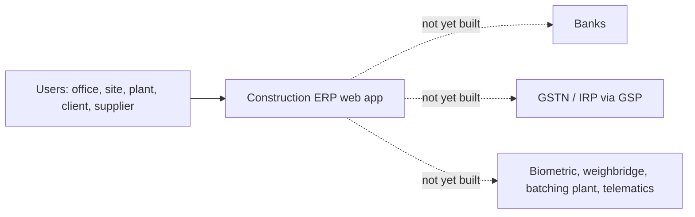
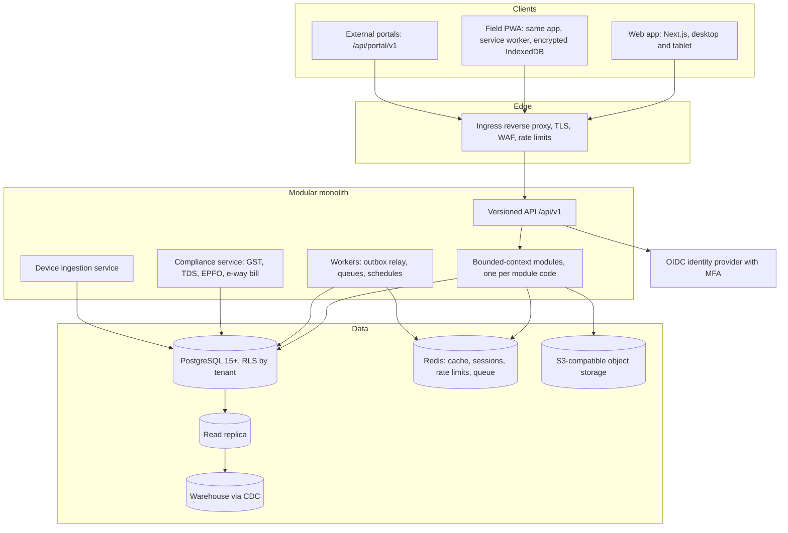

# ARCHITECTURE

Part 02, REQ-ARCH-F01. Current and target views of the Construction ERP. Status: **APPROVED by the owner on 2026-10-19** for this document set. ADR-000 and ADR-003 are accepted. ADR-001, ADR-002 and ADR-004 to ADR-011 remain **PROPOSED**; Part 02's acceptance criterion requires them approved or marked not applicable (see CF-019).

Decisions are recorded in `adr/ADR-000` to `ADR-011`. This document shows how they fit together.

## 1. Context view (current)

Today the only actor-facing system is the shell (`src/app`). The dotted links are the target integrations (Part 02 §4); none exists (EXISTING_SYSTEM_MAP.md).

## 2. Container view (target)


## 3. Component view: modules
Each module code in Annex C is one bounded context. Folder rule (enforced when the first module is built):

```
src/modules/<code>/
  api/        published service interface; the only import other modules may use
  domain/     entities, rules, formulas (calls Part 22 for money and quantity)
  infra/      database access, external adapters
  events/     events the module publishes and the consumers it registers
```

Today there are no modules. The folders that exist map to the target as follows:

| Existing | Target | Status |
|---|---|---|
| `src/domain/` (Annex B formulas) | Part 22 calculation engine and the owning modules | Reference only (CF-003); not a module |
| `src/program/` | Programme governance tooling, not a business module | Stays outside the business modules |
| `src/design/`, `src/components/`, `src/app/` | Shared front-end layer (Part 12) | Kept |

## 4. Data flow: the master business thread
Organisation → Company → Project → Contract → WBS → BOQ → Item → Rate analysis → Estimate → Budget → Schedule → Work authorisation → Procurement → Commitment → Stores → Execution (DPR) → Quality → Measurement → Billing → Accounts → Actual cost → Forecast (EAC) → P&L → Cash → Closeout.

Each step reads from earlier steps through `api/` or read views and writes only its own tables. Money reaches the ledger only through the posting engine (AC-8). Approvals go only through the workflow engine (AC-11). Files go only through the document service (AC-9).

## 5. Trust boundaries and security zones
| Zone | Contents | Boundary controls |
|---|---|---|
| Public internet | Browsers, PWA, portals | TLS, WAF, rate limits, CSP, cookie flags |
| Application | Web API, modules, workers | Server-side authorisation on every path (N10); signed sessions |
| Data | PostgreSQL, Redis, object storage | Private network; least-privilege database roles; encryption at rest; RLS |
| Integration | Connectors, device ingestion, compliance | Vault for credentials; outbound host allow-list; idempotency |
| Identity | OIDC provider, MFA | Separate service; step-up for privileged actions (SE-8) |

## 6. Deployment
Containers built from one repository. Environments and release process are in `ENVIRONMENTS.md` (ADR-011). Infrastructure as code is not yet written: the cloud provider and region are open (CF-012).

## 7. Current → target: what changes, and what stays
| Area | Current (Part 01) | Target | Change | Preserve |
|---|---|---|---|---|
| Application framework | Next.js 15.5.28 | Next.js (current supported major, decided by TECH_RADAR) | Upgrade as a tested change (R-02) | Routes, shell, design system |
| Money arithmetic | JavaScript numbers | Decimal arithmetic (ADR-004) | Replace before persistence | Formula meaning; golden values reviewed under N4 |
| Authentication | None | OIDC with MFA (ADR-009) | Build (Part 08A) | — |
| Navigation permission | Stub returning true | Server-side policy (SE-8) | Build (Part 07) | Navigation registry |
| Database | None | PostgreSQL with RLS (ADR-002, ADR-003) | Build (Part 03) | Any future legacy data, per §7.1 |
| CI | Tests run by hand | CI workflow (`.github/workflows/ci.yml`) | Added with this Part | Gates unchanged |

## 8. Module boundary rules (REQ-ARCH-F03)
Enforced by `npm run arch:check` (source: `src/program/architecture.ts`):
1. Domain formulas import nothing from UI or programme code.
2. UI files import no domain formula and no programme data (N9).
3. Programme governance does not import UI.
4. Pages reach business logic through module services, not formulas.

Rules for modules (applied when `src/modules/` exists): cross-module imports only through `api/`; no cross-module table access in SQL or ORM; later Parts depend on earlier Parts, never the reverse, except through events. The dependency direction follows Annex C.

## 9. Fitness functions (REQ-ARCH-F17)
| Fitness function | Where | Blocks? |
|---|---|---|
| Boundary and dependency allow-list | `npm run arch:check`, CI job `quality` | Yes |
| Golden baseline (destructive change) | `npm run baseline:check`, CI job `quality` | Yes |
| Lint, typecheck, tests, build | CI job `quality` | Yes |
| Design contrast gate (DS-7) | CI job `design-gate` | No, until CF-004 is decided |
| Production dependency audit (R-02) | CI job `security-audit` | No, until the upgrades are decided |
| API diff, migration lint, performance smoke, bundle budget | Parts 03, 04, 09 | Not yet built |

## 10. Non-functional targets mapped to tactics (Part 02 §15)
| Target (Part 00 §10.3) | Tactic | Fitness function |
|---|---|---|
| List p95 < 500 ms at 100k rows | Keyset pagination, covering indexes, read replica for reports | Load probe (Part 01 pattern) |
| Record page < 1 s | Read models for heavy screens; cache with event invalidation | Performance smoke in CI |
| Search < 500 ms | PostgreSQL full-text search; OpenSearch only if the trigger is met (ADR-003) | Search latency test |
| `protocol.check` < 50 ms | Rules evaluated in-process with cached reference data | Benchmark in Part 17 |
| Event to consumer ≤ 5 s | Outbox relay on a short schedule; Redis queue | Event latency test (Part 10) |
| FCP < 2 s on 4G for field screens | Code splitting; PWA shell cache | Lighthouse budget |
| 72 h offline capture | Encrypted IndexedDB store; command queue (ADR-008) | Offline scenario tests |
| RPO ≤ 15 min, RTO ≤ 4 h | PITR on the managed database; cross-region replica (ADR-011) | Restore drill (Part 84) |
| 99.9 % availability | Stateless app tier behind ingress; health checks; blue-green | Uptime monitoring (Part 09) |
| WCAG 2.2 AA | Design system tokens and focus rules (Annex A DS-30) | axe in CI once screens exist |

## 11. Replacement roadmap (REQ-ARCH-F16)
Governed replacements (Part 00 §7.4). Only one exists today.

| # | Replacement | Criterion (§7.3) | Evidence | ADR | Sequenced in | Owner | Rollback |
|---|---|---|---|---|---|---|---|
| 1 | Money and quantity arithmetic: JavaScript numbers → decimal | 5 (integrity impossible) | Golden case 999.9999999999995 | ADR-004 | Before Part 22 persistence; no legacy data | Technical lead; Part 22 owner | Revert before persistence |
| 2 | Application framework upgrade Next 15 → current major | 4 (known advisories; upgrade path exists) | npm audit (R-02) | ADR-000 amendment (to be written) | After CI is green, before Part 03 | Technical lead | Revert the lockfile |

No replacement may run during a financial period close (Part 00 §7.4).

## 12. Open items
- CF-011: Part 01 is unsigned; Part 02 is drafted, not approved.
- CF-012: cloud provider and region unknown; IaC not written.
- CF-013: identity provider data residency unconfirmed (ADR-009).
- CF-014: non-blocking CI jobs (design contrast, production audit).
